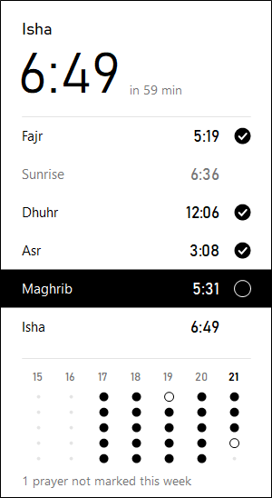
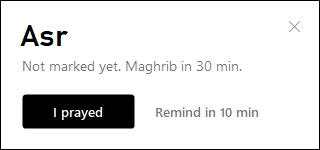

# Prayer Tray

A tiny Windows taskbar app that keeps UAE prayer times in reach and makes sure you don't forget to pray while you work.

<p>
  
  &nbsp;
  
</p>

## What it does

- **Athan alert** at every prayer time, with an **I prayed** button.
- **Reminder 30 minutes before the next prayer** if you haven't marked the current one (snooze for 10 min). For Fajr it's 30 minutes before sunrise.
- **Heads-up 10 minutes before** each athan, without sound.
- **Weekly history**: one dot per prayer for the last 7 days. Click a dot to fix it.
- **Any area in the UAE**: right-click the icon, open the location item, and search or browse by emirate.
- **Ramadan**: shows the Suhoor and Iftar countdown at the top.
- **Morning and evening adhkar** reminders (can be turned off).
- **Alt+P** marks the current prayer as prayed from anywhere.
- Plays no sound during fullscreen apps and presentations, or always with **Silent alerts**.
- Starts with Windows. Uses about 5–25 MB of RAM and almost no CPU.

Prayer times come from the General Authority of Islamic Affairs, Endowments & Zakat ([awqaf.gov.ae](https://www.awqaf.gov.ae/prayer-times)). The app downloads 30 days at a time, so it keeps working offline.

## Install

Download `PrayerTray.exe` from [Releases](../../releases) and run it. It goes to your taskbar and adds itself to startup.

Windows SmartScreen may warn because the app isn't signed. Choose **More info → Run anyway**, or build it yourself.

## Build it yourself

No SDK needed. Windows already ships the C# compiler.

```powershell
.\build.ps1
```

This compiles `PrayerTray.cs` and copies the app to `%LOCALAPPDATA%\PrayerTray`. To use your own athan sound, put an `adhan.wav` next to `build.ps1` before building.

## Your data

Settings and the prayers you mark stay on your PC in `%LOCALAPPDATA%\PrayerTray\data.json`. The only network calls go to the Awqaf prayer-times service.

## Notes

Unofficial. Not affiliated with or endorsed by Awqaf. The app uses the same public prayer-times service as the awqaf.gov.ae website.

MIT licensed.
